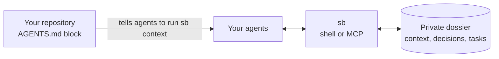

# SecondBrain

Private context, decisions and tasks for your coding agents, kept outside your repositories.

`sb` is a single program for Windows, macOS and Linux. It keeps one plain-Markdown dossier per Git repository in a private folder and shares it with your agents (Claude Code, Codex, Gemini CLI, Cursor, VS Code and others) through the shell or MCP.

> **Version: 1.0.0.**

## Quick setup

You need [Git](https://git-scm.com/downloads) and a terminal. Five steps:

1. **Install `sb`.** Download the archive for your system from [GitHub releases](https://github.com/dennidalpos/SecondBrain/releases), or build it with Rust 1.89 or later:

   ```sh
   cargo install --locked --path ./cli
   ```

   Full instructions, checksums and `PATH` setup for every system are in [Install](cli/README.md#install).

2. **Check it works.** Open a new terminal:

   ```sh
   sb --version
   ```

3. **Create your data folder** (once per machine):

   ```sh
   sb init
   ```

4. **Link a project** (once per Git repository, from inside it):

   ```sh
   cd path/to/project
   sb add
   ```

   This adds a short managed block to `AGENTS.md` and a `CLAUDE.md` that points to it. Commit them if you want the project's agents to find it.

5. **Connect your agent** (optional, for desktop apps and IDEs), then reopen the client:

   ```sh
   sb mcp install --client claude-code
   ```

   Other clients: `codex`, `claude-desktop`, `cursor`, `vscode`, `gemini`, `copilot`, `windsurf`, `devin`. List them with `sb mcp clients`.

Then run `sb start` to see the state of the project and the next steps. In a connected chat, ask the agent: "Onboard this repository" (it reads `sb guide onboarding`), or "Run the next 3 eligible tasks here".

### Your first task

```sh
sb task add "Fix the login redirect" --body "Keep the requested return URL" --priority 2
sb task ready          # what can start now
sb run --dry-run       # preview an unattended run, nothing is executed
```

## How it fits together



The dossier lives in your user data folder, never in the repository. [Data layout](cli/README.md#data)

## What you get

- **Context per repository:** current state, dated decisions and tasks.
- **Tasks for agents:** ready queue, claims with a lease, interviews with `sb task prepare`, unattended runs with `sb run` on a separate branch (local commits only).
- **Sources and search:** `sb kb add` stores documents; `sb search` ranks with SQLite FTS5 and BM25, no model and no network.
- **Publication check:** `sb check` scans for secrets, personal data and copied dossier text before you push.
- **Backup and sync:** `sb export`, `sb import` and `sb sync` move the dossier between machines.

## Documentation

- [User guide](cli/README.md): install, rules, tasks, unattended runs, publication checks, data and MCP setup.
- [Command reference](COMMANDS.md): every command, parameter and MCP tool with examples. `sb commands` prints it in the terminal.
- [Contributing](CONTRIBUTING.md) and [security policy](SECURITY.md).

## License

MIT. See [LICENSE](LICENSE) and [CREDITS.md](CREDITS.md).
