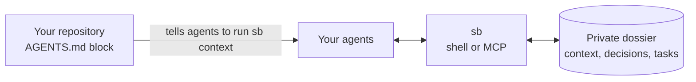

# SecondBrain

Private context, decisions and tasks for your coding agents, kept outside your repositories.

## Purpose

`sb` is a single program for Windows, macOS and Linux. It keeps one plain-Markdown dossier per Git repository in a private folder and shares it with your agents (Claude Code, Codex, Gemini CLI, Cursor, VS Code and others) through the shell or MCP. The dossier never lives in the repository, and `sb check` scans a push for secrets, personal data and copied dossier text. Version 1.0.0.



## Requirements

[Git](https://git-scm.com/downloads) and a terminal. To build from source, Rust 1.89 or later.

## First setup

1. **Install `sb`:** download the archive for your system from [GitHub releases](https://github.com/dennidalpos/SecondBrain/releases), or build it:

   ```sh
   cargo install --locked --path ./cli
   ```

   Checksums and `PATH` setup are in [Install](cli/README.md#install). Check it with `sb --version` in a new terminal.

2. **Create your data folder** (once per machine): `sb init`
3. **Link a project** (once per Git repository, from inside it): `sb add`. This adds a managed block to `AGENTS.md` and a `CLAUDE.md` that points to it; commit them if you want the project's agents to find it.
4. **Connect your agent** (optional), then reopen the client: `sb mcp install --client claude-code`. Other clients: `sb mcp clients`.

Then run `sb start` to see the state of the project and the next steps.

## Usage

```sh
sb task add "Fix the login redirect" --body "Keep the requested return URL" --priority 2
sb task ready          # what can start now
sb run --dry-run       # preview an unattended run, nothing is executed
sb check               # before every push
```

Also: decisions (`sb decide`), sources and search (`sb kb add`, `sb search`), and backup or sync between machines (`sb export`, `sb import`, `sb sync`). In a connected chat, ask the agent: "Onboard this repository", or "Run the next 3 eligible tasks here".

## Build and test

From `cli/`: `cargo fmt --check`, `cargo clippy --locked --all-targets -- -D warnings` and `cargo test --locked`. See [Contributing](CONTRIBUTING.md).

## Documentation and security

[User guide](cli/README.md) · [Command reference](COMMANDS.md) (`sb commands` prints it) · [Contributing](CONTRIBUTING.md) · [Security policy](SECURITY.md) · [License](LICENSE) (MIT; [CREDITS.md](CREDITS.md)).
