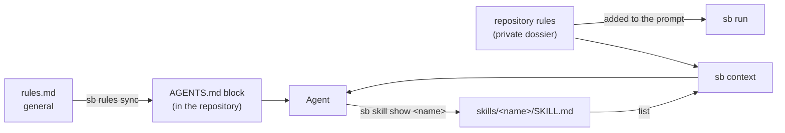
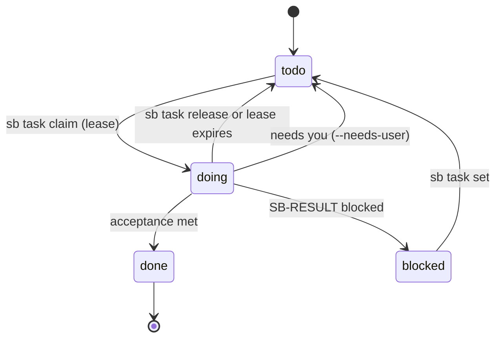

# SecondBrain user guide

Start with the [quick setup](../README.md#quick-setup) in the main README. Use `sb commands` or the [command reference](../COMMANDS.md) to see a description and example next to each command and parameter.

The start screen visits all locally recorded checkouts, including when started outside Git. For each checkout whose Git identity still matches its dossier, it refreshes the existing SecondBrain block in `AGENTS.md` and recreates a missing `CLAUDE.md` pointer. It reports each repair and shows how to address remaining findings, such as linking a checkout with `sb add` or refreshing a stale MCP registration. A checkout linked with `sb add --no-files` can keep that setup. Command menus such as `sb start work task` are read-only.

A repository without a GitHub remote is identified as `local/<name>@<hash>`, which follows its folder. If you move or rename the folder, run `sb relink <identity-or-name>` inside it (`sb repos` lists the identities, and `sb doctor` suggests the command): the context, decisions and tasks follow, and the old path is forgotten.

The dashboard shows the running executable and first native `sb` on `PATH`. It looks for newer build markers on `PATH`, in Cargo's bin directory and in the default build folders of the current or recorded SecondBrain source checkouts. Build markers carry the package version, a source fingerprint and a build time, so copying a file or building the same source in another profile does not make it newer. A higher version takes precedence. Within the same version, a later build from different source takes precedence. A marked newer build pauses repairs. The dashboard also flags MCP configurations that point to an older marked build. Executables without a build marker can still be shown as the first `sb` on `PATH`, with their age unknown. Shell aliases and wrappers can be checked with the shell's own command lookup.

## Install

Install Git on the machine and check that `git --version` works in a terminal. Git is used to identify checkouts and manage repository work. Then use the instructions that match what you downloaded.

### If you downloaded the source or cloned this repository

1. Install Rust with `rustup` and use Rust 1.89 or later. On Windows, install the Visual Studio C++ build tools if `rustup` asks for them. [Official Rust installation instructions](https://rust-lang.org/tools/install/)
2. Extract the source ZIP if needed. Open a terminal in the extracted or cloned folder that contains `cli/Cargo.toml`.
3. Build and install the executable, then verify the terminal can find it.

   ```sh
   cargo --version
   cargo install --locked --path ./cli
   sb --version
   ```

Cargo installs into `%USERPROFILE%\.cargo\bin` on Windows or `~/.cargo/bin` on macOS and Linux by default. If `sb --version` fails, open a new terminal. If it still fails, add Cargo's bin directory to your user `PATH`.

### If you downloaded a prebuilt archive

Choose the archive that matches your system and architecture. Prebuilt archives contain `sb.exe` on Windows and `sb` on macOS and Linux. [GitHub releases](https://github.com/dennidalpos/SecondBrain/releases)

| System | Target | Format |
|---|---|---|
| Windows x64 | `x86_64-pc-windows-msvc` | `.zip` |
| Windows ARM64 | `aarch64-pc-windows-msvc` | `.zip` |
| macOS Apple Silicon | `aarch64-apple-darwin` | `.tar.gz` |
| macOS Intel | `x86_64-apple-darwin` | `.tar.gz` |
| Linux x64 | `x86_64-unknown-linux-musl` | `.tar.gz` |
| Linux ARM64 | `aarch64-unknown-linux-musl` | `.tar.gz` |

The archive name is `sb-v<version>-<target>`. Compare its SHA-256 hash with the release's `SHA256SUMS` before extracting. PowerShell can compute it with `Get-FileHash <archive> -Algorithm SHA256`. Use `shasum -a 256 <archive>` on macOS or `sha256sum <archive>` on Linux. If you have GitHub CLI, `gh attestation verify <archive> --repo dennidalpos/SecondBrain` verifies build provenance.

**Windows (PowerShell)**

Extract the ZIP and open PowerShell in the folder containing `sb.exe`. Copy the binary and add its directory to the user `PATH`.

```powershell
$sbBin = Join-Path $env:LOCALAPPDATA 'SecondBrain\bin'
New-Item -ItemType Directory -Path $sbBin -Force | Out-Null
Copy-Item -LiteralPath '.\sb.exe' -Destination (Join-Path $sbBin 'sb.exe')
$sbUserPath = [Environment]::GetEnvironmentVariable('Path', 'User')
if ($sbBin -notin ($sbUserPath -split ';')) {
    [Environment]::SetEnvironmentVariable('Path', "$sbBin;$sbUserPath", 'User')
}
$env:Path = "$sbBin;$env:Path"
sb --version
```

**macOS and Linux**

Extract the archive and open a terminal in the folder containing `sb`. Install it for your user account.

```sh
mkdir -p "$HOME/.local/bin"
install -m 0755 ./sb "$HOME/.local/bin/sb"
export PATH="$HOME/.local/bin:$PATH"
sb --version
```

Add the `export PATH` line to the startup file for your shell, such as `~/.zshrc` or `~/.bashrc`, to use `sb` in new terminals.

The binaries are unsigned. macOS may require approval in **System Settings → Privacy & Security**. Windows SmartScreen may warn on first run.

### Update an existing installation

Replace the binary with the new release archive, or run `cargo install --locked --force --path ./cli` from the updated source folder. If Windows reports that `sb.exe` is in use, close the clients running `sb mcp` before replacing it and reopen them afterward.

Version 1.0.0 continues the 5.0.0-alpha.1 prerelease and reuses its data folder. To identify the executable used by the terminal, run `Get-Command sb -All` in PowerShell or `command -v sb` in a POSIX shell. From the source folder, `cargo run --locked --manifest-path ./cli/Cargo.toml -- start` opens the dashboard directly from the checkout.

## Start screen

The start screen lists the checkout path, its GitHub URL when the origin points to GitHub, the linked dossier, context and task counts. Local alignment covers the checkout record, managed agent files, task files, the optional pre-push hook and MCP registrations. It reads the client configuration. Use the client's MCP status for a live connection check and `sb doctor` for a full scan.

The screen lists the open tasks with their number, state (ready, needs input, in progress or waiting for other tasks), priority and title, up to eight, and a quick start for the current queue: a batch of ready tasks in the desktop app (the chat workflow), an unattended run in the CLI (`sb run --dry-run`, then `sb run --all`), handing tasks that need input to unattended work (`sb task prepare <ID>` in the CLI, or the same interview requested from the chat agent) and one task at a time with the next ready task suggested. Up to three tips follow, and a link to the full [command reference](../COMMANDS.md). Command menus and parameters live in `sb start <AREA>` and `sb commands`, not on the start screen.

Use `sb start work task add` to see the syntax and an example for each task creation option. Use `sb guide onboarding` when a linked checkout still needs its initial context.

## Rules and skills

- **General rules** (`rules.md`) apply to every repository. `sb rules set --general` replaces them from standard input, and `sb rules sync` copies them into the managed block of every linked `AGENTS.md`.
- **Interviews and approvals** are part of the managed block: with several possible scenarios, or before leaving the stated intent, agents ask with the client's structured question tool and propose options; approvals (push, installs, network, deletions, accounts) are collected before a task starts, so an unattended run is not interrupted. `sb task prepare` records them as **Authorizations**.
- **Directive version** identifies the exact normalized managed text, including shared rules. It is stamped in the block and displayed by `sb start`. Use `sb rules sync --agent-file ./agent-profile/AGENTS.md` to refresh managed text in a global agent instructions file. Repeat `--agent-file` to select more files. Add `--check` to compare the entire managed block without writing. Existing personal instructions outside the markers are preserved and the original file is backed up on the first change.
- **Repository rules** are kept in the private dossier. `sb rules set --repo <name>` replaces them from standard input and `sb rules show` prints both levels. Agents read them from the dossier through `sb context` and receive them in the `sb run` prompt.
- **Skills** are `SKILL.md` files (front matter `name` and `description`, then the instructions) stored once in `<data folder>/skills/<name>/`. `sb skill add <name> --file SKILL.md` stores one; agents see the list in `sb context` and read one with `sb skill show <name>` (or the MCP tools `list_skills` and `get_skill`) when the work calls for it.



## Tasks

Use `sb task list` to see open work and `sb task ready` to see what can start. A task becomes ready once its prerequisites are complete and nobody holds an active claim. `sb task claim` sets it to `doing` for a limited time. After the lease expires, it can become ready again. Use `sb task release` to return a claimed task to `todo` before that.



Use `--needs-user` when a person must act or decide. Set an optional `--accept` command through the CLI to verify a task before an unattended run marks it done. See [Task commands](../COMMANDS.md#tasks).

In a connected chat, ask the agent to run task 7 or work through the next 3 eligible tasks. The agent can load `get_guide` with `topic: "chat"` and claim each task immediately before doing the work. [MCP examples](../COMMANDS.md#mcp-tools)

### Prepare a task for unattended work

Run `sb task prepare <ID>` and answer one line per question. Provide the scope and acceptance criteria, then any checks, inputs, decisions or constraints. An optional acceptance command is saved for a future run. Press Enter to keep the existing command.

Finish with `ready` when the agent has what it needs. Use `hold` to save the handoff while marking the task as needing a person. `cancel` leaves the task as it was. A later interview replaces the saved handoff while preserving the original description. Check task readiness and preview the run before starting it.

To prepare every task that waits for input, run `sb prepare` or ask the chat agent "Prepare all tasks that need input". The agent loads `get_guide` with `topic: "prepare"`, lists the queue with `prepare_queue`, interviews you with its structured question tool and saves each answer set with `prepare_task` (`ready` or `hold`).

## Sources

Sources keep what a repository's documents, web pages, chats and media say, so an agent can find them again. The caller extracts the text: in a desktop app the agent reads the file with its own tools (OCR, transcription, a connector for Notion, GitHub or Slack) and calls the MCP tool `add_source`, or a person runs `sb kb add`. sb stores the text as Markdown chunks in `kb.db` inside the dossier and indexes it with SQLite FTS5 and BM25. Read `sb guide sources` for the full workflow.

Each source has a PARA group: `project` (tied to a goal or task), `area` (an ongoing responsibility), `resource` (reference) or `archive` (inactive, still searchable and ranked lower), plus tags, a summary and an optional task. Storing the same origin again creates a new revision, and storing the same text twice is refused. Text that looks like a secret or personal data is refused until the user agrees (`--allow-sensitive`).

An original file can be copied once with `--original FILE` (MCP `original_path`) into `originals/<repository folder>/` in the data folder, or under `SB_ORIGINALS`, which must be outside any Git repository. That folder is for the user: sb never opens, indexes, exports or deletes the copies after the copy, and `sb kb rm` leaves them in place. `sb kb stats` lists copies without a source by name. `sb context` shows the number of sources per group and the newest titles, `sb search` adds source hits labelled `src#N`, and `sb kb search` shows snippets.

`sb kb compact` shrinks the sources without a model: it drops superseded revisions, exact duplicate chunks (hash) and near-duplicate chunks (64-bit simhash over three-word shingles, Hamming distance 3 or less), strips lines repeated in at least three chunks of one source and base64 blobs, then runs `VACUUM` and an FTS5 optimize. The first copy is kept and a source never loses its last chunk. Use `--dry-run` to see the counts first. Originals are not touched.

## Unattended runs

```sh
sb run --dry-run
sb run --agent claude --model sonnet --effort high --limit 3 --timeout 30
sb run --agent-cmd "my-agent --flag" --task 12
```

- The working tree must be clean. One `sb run` at a time owns each Git worktree. The run creates an `sb/run-<UTC time>` branch from the current one, or reuses it if you are already on one.
- Each task gets a fresh agent process. The prompt (the task, the project context and the rules) goes to its standard input, and the agent must end with one of three lines: `SB-RESULT: done`, `SB-RESULT: blocked <reason>` or `SB-RESULT: needs-user <what is needed>`.
- The built-in launchers use `acceptEdits` for Claude Code, `auto_edit` for Gemini CLI and `workspace-write` for Codex. `sb run` also pre-approves the programs a task names: those in its acceptance command, in the **Commands** answer of `sb task prepare` and in `--allow-cmd`. Claude Code gets `--allowedTools Bash(program:*)`, Gemini CLI 0.68 and later gets `--policy` with a per-run policy file under the data folder (older builds keep `--allowed-tools run_shell_command(program)`), and Codex runs commands inside its `workspace-write` sandbox. Every other shell command stays denied; a custom `--agent-cmd` gets none. A task whose programs are not on the PATH is skipped before it starts. An acceptance command runs separately in the checkout after an agent reports success. If it fails, the task becomes blocked.
- `sb` commits each task's changes locally: `Complete sb task #id` when it is done, `Not done: sb task #id` otherwise (never the task title, which is private text, so `sb check` accepts the branch). It never pushes. Tasks become `done`, `blocked`, or `todo` with "needs you"; each gets a dated note and the path of its log, which stays in the dossier, not in the repository.
- The run stops when an agent switches branch or its output looks like a usage limit. In a terminal, SecondBrain can ask for the built-in agent and run settings. See [Run options](../COMMANDS.md#context-and-work) for noninteractive invocation.
- If a task claim expires or changes owners while the agent runs, the runner leaves its edits in the worktree for review.
- Review the commits against the branch you started from before merging.

## Publication check

```sh
sb check                     # working tree + commits not on any remote; exit 2 on findings
sb check --history           # every commit of every branch
sb check --json
sb check --install-hook      # Git pre-push hook that blocks the push on findings (--uninstall-hook)
```

- **Rules:** secrets (private keys; AWS, GitHub, Anthropic, OpenAI, Slack, Google and Stripe live keys; `password = "..."` assignments; credentials in URLs) and personal data (email addresses, home folders such as `C:\Users\<name>` or `/home/<name>`).
- **Dossier leaks:** text from the repository's own dossier (task titles, context and decisions) copied into a file. Only SecondBrain can check this one.
- **Git coverage:** checks include commit messages and changed Git blobs, including merge results. For a pre-push update, the destination's old object ID sets the range. A new ref or an unknown destination object is checked from the local tip through its full history.
- **Kept quiet on purpose:**
  - placeholders (`${VAR}`, `your-key`, `example`);
  - safe addresses (`example.com`, `.invalid`, noreply);
  - SSH remotes (`git@host:`);
  - personal data in license, notice, lockfile and vendored files;
  - generic credential values in test files;
  - the repository's own user in containers;
  - binary formats.
- **Silencing a reviewed false positive:** add `sb-check: ignore` to the line, or put its fingerprint (shown in brackets) and a reason in a tracked `.sbcheck-ignore`.
- **A secret that was already committed** stays in the history even after you delete the file: rotate it, then rewrite the unpushed commits.

The check covers eligible working-tree files and added lines in commit diffs. Commit messages and merge resolutions are outside that coverage. The hook runs the same scanner. Use exit code 2 to detect findings. See [Publication commands](../COMMANDS.md#publication-and-data-transfer).

## Data

The default data folder is `%LOCALAPPDATA%\sb` on Windows, `~/Library/Application Support/sb` on macOS, and `$XDG_DATA_HOME/sb` or `~/.local/share/sb` on Linux. Override it with `SB_HOME` or `--home`.

```text
<data folder>/
  rules.md                         general rules
  skills/<name>/SKILL.md           stored skills
  index.db                         rebuildable local search index
  originals/<repository folder>/   copies of original files, for the user only
  repos/<repository folder>/
    repo.json                      repository identity
    paths.json                     checkout paths on this machine
    rules.md                       private repository rules
    context.md                     current state
    decisions.md                   dated decisions
    tasks/<id>-<title>.md          task front matter and body
    kb.db                          sources and their search index (local, not synchronized)
    runs/                          local agent prompts and output
```

A checkout normally resolves to its dossier through its `origin` remote. Local repositories fall back to the checkout folder name. Use separate names for unrelated local checkouts.

`sb import` copies supported agent instructions into the linked repository's private rules. Use `--dry-run` to preview it. `sb export` produces Markdown or JSON for backup and sharing. `sb export --format sqlite --out team.sbkb` packs one repository (sources, context, decisions, rules, tasks; no originals or paths) and `sb import --pack team.sbkb [--merge|--replace] [--dry-run]` brings it into another home after checking the schema, the identity and secrets; `--replace` backs up first. `sb kb export --out DIR` writes the sources as Markdown files.

`sb sync` uses Git and scans local files and outgoing history for secrets and personal data. The data is unencrypted. Use a private remote. Git ignores the search index, the source databases, the originals folder, local checkout paths, run logs and the task lock by default. Move sources between machines by copying `kb.db` and `originals/` yourself until an export pack exists. Review the local changes before adopting a remote in a data folder containing customized files.

## MCP

`sb mcp` serves local tools over standard input and output. See the [MCP command and tool reference](../COMMANDS.md#mcp).

```sh
sb mcp clients
sb mcp install --client codex
sb mcp config --client vscode
```

| Client | Integration |
|---|---|
| `claude-desktop` | Local stdio server in `claude_desktop_config.json`. Windows checks the Microsoft Store package and roaming configuration. Set `CLAUDE_DESKTOP_CONFIG_DIR` to the configuration directory for a specific profile. [Claude Desktop local MCP](https://support.claude.com/en/articles/10949351-getting-started-with-local-mcp-servers-on-claude-desktop) |
| `claude-code` | User-scoped registration through `claude mcp add`. The start screen also reads registrations from `CLAUDE_CONFIG_DIR` when set. The `claude` process runs with `HOME`, `USERPROFILE` and `CLAUDE_CONFIG_DIR` pinned to the profile sb resolved, so an isolated profile (temporary `USERPROFILE`/`HOME`) never writes the real user config. [Claude Code MCP](https://code.claude.com/docs/en/mcp) |
| `codex` | `[mcp_servers.secondbrain]` in `$CODEX_HOME/config.toml`, defaulting to `~/.codex/config.toml`. The CLI, desktop app and IDE extension share configuration on the same Codex host. [Codex MCP](https://learn.chatgpt.com/docs/extend/mcp?surface=cli) |
| `cursor` | `~/.cursor/mcp.json` is shared by the editor and its CLI on the same machine. [Cursor CLI MCP](https://cursor.com/docs/cli/using) |
| `vscode` | The editor-managed user-profile `Code/User/mcp.json`. [VS Code MCP configuration](https://code.visualstudio.com/docs/agents/reference/mcp-configuration) |
| `copilot` | Copilot Global in `$COPILOT_HOME/mcp-config.json`, defaulting to `~/.copilot/mcp-config.json`. [Copilot CLI MCP configuration](https://docs.github.com/en/copilot/how-tos/copilot-cli/customize-copilot/add-mcp-servers) |
| `devin` | Devin CLI and Devin Local global `devin/mcp_config.json` under `DEVIN_CONFIG_HOME` when set, or the OS configuration directory. [Devin CLI MCP configuration](https://docs.devin.ai/cli/extensibility/mcp/configuration) |
| `windsurf` | `~/.codeium/windsurf/mcp_config.json` for the Windsurf editor. Devin Desktop uses Devin CLI discovery. [Devin Desktop customization](https://docs.devin.ai/desktop/devin-local/customizations) |
| `gemini` | `~/.gemini/settings.json`, or `$GEMINI_CLI_HOME/.gemini/settings.json`. Gemini can disable MCP in an untrusted workspace. [Gemini CLI trusted folders](https://geminicli.com/docs/cli/trusted-folders/) |

- **Which binary:** the entry uses the absolute path of the `sb` that ran the command, because desktop apps do not see your shell's PATH. When `--home` or `SB_HOME` is set, the entry also sets `SB_HOME`.
- **Existing configuration:** other servers and settings are kept in their order. For files edited directly, SecondBrain backs up the original to `<file>.sb-backup` before the first change. For JSONC, print the entry with `sb mcp config` and add it in the client. Claude Code registration is delegated to its CLI.
- **Registration status:** the MCP row in `sb start` reads known local user configuration files. Use the client's MCP status to check whether it can connect. Restart the client after installing.
